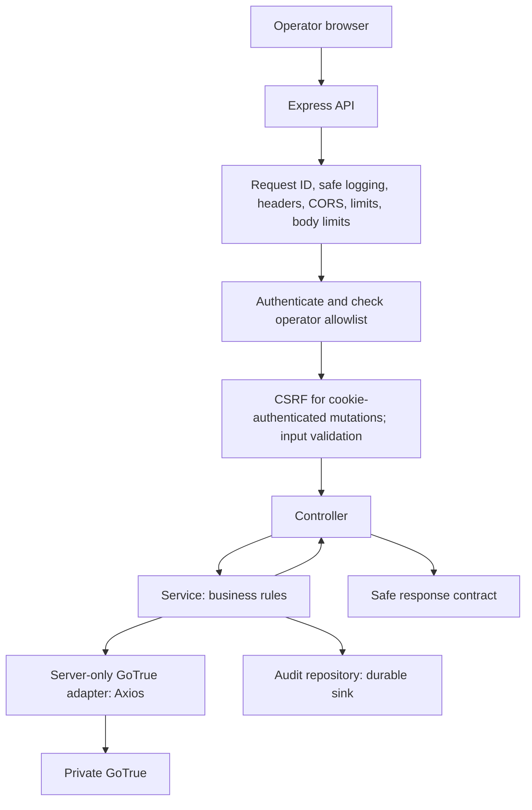

# GoTrue Admin API: Backend Architecture

The initial health/operator-session backend is implemented with isolated tests. Live PostgreSQL/GoTrue verification awaits user setup. Later modules remain planned unless their API reference says otherwise. Read alongside [V1 features](features.md) and [shared architecture](../architecture-and-deployment.md).

This file owns backend structure, technology choices, and agreed session/audit/provisioning policies. [API reference](api.md) owns endpoint contracts and usage. [AGENTS.md](../../AGENTS.md) owns coding and delivery rules.

## Scope and ownership

Build `apps/gotrue-admin-api` first: an Express/TypeScript API for trusted operators. The frontend calls this API; the API calls private GoTrue through a server-only adapter. GoTrue owns identities, passwords, and its auth schema. This API owns operator authorization, its session boundary, input/output contracts, and management audit records. It never queries or modifies GoTrue tables directly.

## Technology stack

| Component                    | Choice                                | Purpose                                                                                               |
| ---------------------------- | ------------------------------------- | ----------------------------------------------------------------------------------------------------- |
| Runtime                      | Node.js supported LTS                 | Run compiled JavaScript in production; pin exact version during scaffolding                           |
| Language                     | TypeScript, strict mode               | Explicit contracts and compile-time checks                                                            |
| HTTP framework               | Express                               | Routes, controllers, and middleware                                                                   |
| Upstream HTTP                | Axios                                 | Configured GoTrue client with timeouts and safe error mapping                                         |
| Validation                   | Zod                                   | Validate environment, parameters, queries, and request bodies                                         |
| Application/request logging  | Pino + pino-http                      | Structured logs, request correlation, configured secret redaction                                     |
| Security headers             | Helmet                                | API-appropriate HTTP security headers                                                                 |
| Browser origins              | cors                                  | Exact trusted frontend origins with explicit credentials policy                                       |
| Request limits               | express-rate-limit                    | Separate login/recovery and general API limits                                                        |
| Development                  | tsx watch                             | Run/restart TypeScript in the foreground; nodemon is unnecessary                                      |
| Build                        | TypeScript compiler                   | Type-check and emit production JavaScript                                                             |
| Tests                        | Vitest + Supertest                    | Meaningful service and HTTP integration tests                                                         |
| Formatting/checks            | ESLint + Prettier                     | Consistent code and static checks                                                                     |
| Package/workspace management | pnpm workspaces                       | Independent apps and shared packages in one repository                                                |
| JWT verification             | Deferred: jose if needed              | Add only if the session design uses local JWT verification                                            |
| Persistence                  | PostgreSQL + pg                       | Separate restricted admin database for sessions and durable audit; SQL migrations and queries, no ORM |
| Cookies                      | cookie-parser                         | Read the opaque operator session cookie; Express sets/clears it                                       |
| Session cryptography         | Node.js crypto                        | Random session IDs, SHA-256 hashes, AES-256-GCM token encryption                                      |
| CSRF                         | Exact Origin + required custom header | Enforce the agreed browser-mutation policy in middleware; no separate token service                   |

Pin compatible dependency versions when scaffolding. No Redis, queue, ORM, or additional service is assumed for V1. Use [agreed V1 decisions](#agreed-v1-decisions) for cookie/CSRF behavior, one-hour sessions without refresh, encryption, audit, provisioning, and initial endpoint contracts.

Pino redaction must explicitly cover sensitive fields. Prefer logging an allowlist of safe metadata; omit bodies, cookies, authorization headers, token-bearing query strings, and raw Axios request/error objects. Operational logs do not replace durable audit history.

## Programming style: classes

Use classes consistently for controllers, services, repositories, and GoTrue clients. This is the agreed application-layer convention. Related methods are accessed through dot notation, such as `usersService.getUser(id)`.

Inject dependencies through constructors and wire instances once in `app.ts`. No dependency-injection framework is needed. Use small TypeScript interfaces where substitution makes testing or adapter boundaries useful. Use composition rather than inheritance; avoid generic base controllers, services, and repositories.

Controllers translate HTTP; services implement business rules without Express request/response objects; repositories access owned storage; clients call upstream APIs. Keep dependencies readonly. Never store request-specific users, tokens, or request IDs on shared instances. Pass request context as method arguments.

Use arrow-function handler properties for Express callbacks to preserve `this`. Custom middleware can expose handlers from dedicated classes; register third-party middleware normally. Types, Zod schemas, constants, and configuration remain ordinary TypeScript declarations. Do not create empty wrapper classes merely to enforce OOP.

Example wiring:

```ts
const usersService = new UsersService(gotrueClient, auditService);
const usersController = new UsersController(usersService);
router.get(
  '/:id',
  authenticate.handle,
  requireOperator.handle,
  usersController.getUser,
);
```

The example assumes bound arrow handlers and separate validation/error handling. Keep `app.ts` independent of listening for HTTP tests; `server.ts` owns startup and graceful shutdown.

## Folder structure

```text
apps/
  gotrue-admin-api/
    src/
      app.ts
      server.ts
      config/
        env.ts
      modules/
        operator-auth/
          operator-auth.routes.ts
          operator-auth.controller.ts
          operator-auth.service.ts
          operator-auth.schemas.ts
          operator-auth.types.ts
        users/
          users.routes.ts
          users.controller.ts
          users.service.ts
          users.schemas.ts
          users.types.ts
        audit/
          audit.routes.ts
          audit.controller.ts
          audit.service.ts
          audit.repository.ts
          audit.types.ts
        health/
          health.routes.ts
          health.controller.ts
          health.service.ts
      middleware/
        authenticate.ts
        require-operator.ts
        validate.ts
        csrf.ts
        rate-limit.ts
        request-id.ts
        not-found.ts
        error-handler.ts
      shared/
        errors/
        http/
        logging/
    tests/
      integration/
    .env.example
    package.json
    tsconfig.json
packages/
  gotrue-client/
    src/
      client.ts
      auth.ts
      admin-users.ts
      errors.ts
      types.ts
  contracts/
    src/
      operator/
  database/                    # Admin/platform schema.sql and numbered migrations; see AGENTS.md
infrastructure/
  local/                       # Existing GoTrue/Mailpit Compose
  vm/                          # Future API deployment templates
documentation/
  gotrue-dashboard/
    backend-architecture.md
```

Create files when needed. Unit tests may be colocated beside their modules. Add `*.repository.ts` only for actual storage, and `*.models.ts` only for meaningful domain/persistence models. Do not create duplicate schemas, interfaces, DTOs, and models for identical data. GoTrue user operations use the upstream adapter rather than a database user repository. Session persistence uses owned storage. Follow [database schema and migration rules](../../AGENTS.md#database-schema-and-migrations) for file ownership and user-managed execution.

`packages/gotrue-client` owns Axios/upstream shapes and must remain server-only. `packages/contracts` contains safe frontend-facing contracts; it exports no credentials or upstream internals. Services must not depend on Express request/response objects. Repositories must not depend on controllers.

## Request flow



The diagram shows a protected operation. Login, recovery, and minimal health have their own middleware policies. Install request correlation/logging early; register the not-found handler after routes and the error handler last. Configure proxy trust to the actual deployment topology before relying on forwarded IPs or secure-cookie detection.

## Agreed V1 decisions

These decisions are approved for implementation. Initial sessions and health are implemented; SQL is prepared but the admin database and operator provisioning await user setup. Keep V1 small: existing PostgreSQL, Express/TypeScript, and private GoTrue. No Redis, queue, ORM, automatic session refresh, or operator-role management UI.

### Operator sessions

- Use the existing PostgreSQL server with a separate `admin_local_db` locally and `admin_db` on the VM. Use a restricted admin-owned runtime role. Admin migrations own only admin tables; never query or modify GoTrue tables or grant unrestricted platform access.
- Generate a cryptographically random opaque session ID of at least 32 bytes. Put it in the browser cookie and store only its SHA-256 hash in the session table, alongside operator UUID, creation time, expiry, and the encrypted GoTrue access token.
- Encrypt the access token using AES-256-GCM with a fresh nonce for each encryption and one dedicated 32-byte environment-provided key. Store the nonce and authentication tag with the ciphertext. Keep the key outside the database and repository. Do not reuse GoTrue's signing secret. Key replacement requires invalidating existing sessions in V1; no key-rotation service is needed.
- Do not retain the GoTrue refresh token. Sessions have a fixed maximum lifetime of one hour, capped by the upstream access-token expiry. No sliding expiry or automatic refresh; the operator signs in again after expiry.
- On every protected request, find an unexpired session by its hash, verify the operator remains in the configured allowlist, and ask GoTrue to validate the stored access token and return the identity. The returned UUID must match the session operator. Fail closed on invalid identity or unavailable dependencies; never authorize from the cookie alone.
- Login returns only safe operator ID/email and session expiry. No upstream access/refresh tokens or session ID in response JSON.
- Logout deletes the current local session and clears its cookie. It is idempotent, including an absent or expired session. It does not promise global GoTrue logout or revoke sessions in other applications. If deletion fails, return a safe unavailable error; do not claim server-side invalidation succeeded.

#### Cookies and browser protection

See [API browser policy](api.md#connection-and-browser-policy) for cookie attributes, names, frontend origins, and CSRF requirements. That policy is maintained with the endpoint reference.

### Durable audit history

Use the admin PostgreSQL database for create, ban, unban, and delete attempts. Retain history in V1 with no automatic deletion. Only eligible operators may read it through the API; use bounded pagination. Operational logs do not replace audit records.

1. Persist an intent record before calling GoTrue. Include actor UUID, target UUID when known, action, timestamp, request ID, and status `pending`. Never store passwords, tokens, cookies, or raw upstream payloads.
2. If the intent cannot be persisted, block the upstream mutation and return a safe unavailable error.
3. After a confirmed upstream result, save `succeeded` or `failed`. Record the target UUID returned by successful creation.
4. A timeout, dropped connection, or process crash after intent can leave an uncertain result. Mark it `unknown` when possible; unresolved `pending` records must also be treated as uncertain, never as failure or success. Do not retry the upstream mutation automatically.
5. If GoTrue confirms success but audit completion fails, keep the durable intent and return a safe partial-outcome error with the request ID and known upstream outcome. Do not claim the upstream change rolled back or invite an automatic retry.

Reconciliation is a trusted manual procedure in V1: inspect the intent, check current GoTrue state through supported admin operations, and persist the verified outcome or keep it `unknown` if evidence is insufficient. Current state alone does not always prove which request caused it. An unresolved attempt must not be shown as completed. No queue or reconciliation service is required initially.

### First operator and lockout recovery

1. Create a controlled account in the environment's GoTrue using its supported signup/setup flow, and verify its email. Locally, use Mailpit.
2. Obtain its UUID from a trusted GoTrue response or supported admin operation.
3. Add the UUID to `OPERATOR_UUID_ALLOWLIST`, a server-controlled comma-separated environment setting. Validate it at API startup. No public signup, user metadata, or browser request may edit eligibility.
4. Restart the API with the updated configuration and verify operator login plus ordinary-account rejection. Protected requests check the active configured allowlist on every request; environment edits take effect after restart.

If every operator loses access, a trusted server administrator uses supported GoTrue recovery/admin operations to recover or provision a verified usable account, updates the allowlist, and restarts the API. Keep privileged GoTrue credentials outside browser bundles, logs, and the repository. No public emergency-access endpoint is added. Document commands against the pinned upstream version during implementation; provisioning has not yet been performed.

Last-usable-operator protection for later ban/delete operations remains required by the feature specification, including concurrency handling and failing closed when usability cannot be established.

### API contracts

See [API reference](api.md) for methods, payloads, status codes, health checks, and usage examples. Update that file when endpoint behavior changes.

### Password recovery

Use GoTrue's built-in recovery after the initial login flow works. Send a generic response without disclosing account/operator existence, apply rate limits, and use a fixed trusted gateway callback; never accept arbitrary redirect destinations. Recovery context must expire and be bound to password recovery. Password reset does not grant operator eligibility or establish a dashboard management session; require normal login afterward.

When the gateway successfully completes password reset, invalidate all local operator sessions for that UUID. Do not promise equivalent behavior for out-of-band resets or other applications until tested against GoTrue.

Before coding this module, verify recovery-link format, token exchange, expiry, password-update behavior, and upstream session effects against local GoTrue `v2.196.0`. Then document exact request/response contracts and run the Mailpit walkthrough. These upstream behaviors are not yet verified or finalized here. Creation/confirmation/email, ban duration, and permanent deletion behavior also remain upstream checks for their respective later modules.
