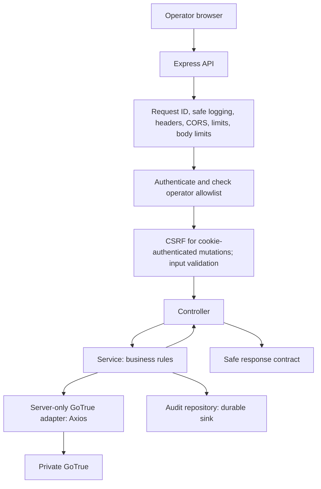

# GoTrue Admin API: Backend Architecture

Design document only. The backend has not been scaffolded or implemented. Read alongside [V1 features](features.md) and [shared architecture](../architecture-and-deployment.md).

## Scope and ownership

Build `apps/gotrue-admin-api` first: an Express/TypeScript API for trusted operators. The frontend calls this API; the API calls private GoTrue through a server-only adapter. GoTrue owns identities, passwords, and its auth schema. This API owns operator authorization, its session boundary, input/output contracts, and management audit records. It never queries or modifies GoTrue tables directly.

## Technology stack

See [technology stack](tech-stack.md) for packages, tooling, environments, and deferred dependencies.

## Programming style: classes

Use classes consistently for controllers, services, repositories, and GoTrue clients. This is the agreed application-layer convention. Related methods are accessed through dot notation, such as `usersService.getUser(id)`.

Inject dependencies through constructors and wire instances once in `app.ts`. No dependency-injection framework is needed. Use small TypeScript interfaces where substitution makes testing or adapter boundaries useful. Use composition rather than inheritance; avoid generic base controllers, services, and repositories.

Controllers translate HTTP; services implement business rules without Express request/response objects; repositories access owned storage; clients call upstream APIs. Keep dependencies readonly. Never store request-specific users, tokens, or request IDs on shared instances. Pass request context as method arguments.

Use arrow-function handler properties for Express callbacks to preserve `this`. Custom middleware can expose handlers from dedicated classes; register third-party middleware normally. Types, Zod schemas, constants, and configuration remain ordinary TypeScript declarations. Do not create empty wrapper classes merely to enforce OOP.

Example wiring:

```ts
const usersService = new UsersService(gotrueClient, auditService);
const usersController = new UsersController(usersService);
router.get('/:id', authenticate.handle, requireOperator.handle, usersController.getUser);
```

The example assumes bound arrow handlers and separate validation/error handling. Keep `app.ts` independent of listening for HTTP tests; `server.ts` owns startup and graceful shutdown.

## Folder structure

```text
apps/
  gotrue-admin-api/
    src/
      app.ts
      server.ts
      config/
        env.ts
      modules/
        operator-auth/
          operator-auth.routes.ts
          operator-auth.controller.ts
          operator-auth.service.ts
          operator-auth.schemas.ts
          operator-auth.types.ts
        users/
          users.routes.ts
          users.controller.ts
          users.service.ts
          users.schemas.ts
          users.types.ts
        audit/
          audit.routes.ts
          audit.controller.ts
          audit.service.ts
          audit.repository.ts
          audit.types.ts
        health/
          health.routes.ts
          health.controller.ts
          health.service.ts
      middleware/
        authenticate.ts
        require-operator.ts
        validate.ts
        csrf.ts
        rate-limit.ts
        request-id.ts
        not-found.ts
        error-handler.ts
      shared/
        errors/
        http/
        logging/
    tests/
      integration/
    .env.example
    package.json
    tsconfig.json
packages/
  gotrue-client/
    src/
      client.ts
      auth.ts
      admin-users.ts
      errors.ts
      types.ts
  contracts/
    src/
      operator/
  database/                    # Reserved platform schema/migrations
infrastructure/
  local/                       # Existing GoTrue/Mailpit Compose
  vm/                          # Future API deployment templates
documentation/
  gotrue-dashboard/
    backend-architecture.md
```

Create files when needed. Unit tests may be colocated beside their modules. Add `*.repository.ts` only for actual storage, and `*.models.ts` only for meaningful domain/persistence models. Do not create duplicate schemas, interfaces, DTOs, and models for identical data. GoTrue user operations use the upstream adapter rather than a database user repository. The persistence choice may add migrations and a session repository later.

`packages/gotrue-client` owns Axios/upstream shapes and must remain server-only. `packages/contracts` contains safe frontend-facing contracts; it exports no credentials or upstream internals. Services must not depend on Express request/response objects. Repositories must not depend on controllers.

## Request flow



The diagram shows a protected operation. Login, recovery, and minimal health have their own middleware policies. Install request correlation/logging early; register the not-found handler after routes and the error handler last. Configure proxy trust to the actual deployment topology before relying on forwarded IPs or secure-cookie detection.

### Operator login and session

1. Validate the login request and apply login rate limits and origin/CSRF policy as appropriate.
2. The auth service submits credentials to GoTrue through Axios.
3. Establish the authenticated UUID and verify the server-controlled operator allowlist. Ordinary valid users receive no operator session.
4. Establish the operator session using the selected session design. Credentials and upstream tokens are never returned as ordinary user fields or logged.
5. Each protected request authenticates the session and rechecks current operator eligibility. A platform session cannot substitute for an operator session.
6. Logout invalidates the operator session and clears its cookie. Define refresh, expiry, upstream revocation, and password-recovery behavior explicitly.

Recommended direction: an opaque HttpOnly operator cookie backed by a server-side session store, with upstream tokens protected at rest. For V1, ask GoTrue to validate the stored access token and return the current identity on protected requests; fail closed if authentication cannot be established. This adds upstream latency but avoids local JWT verification initially. This is a recommendation, not a finalized storage contract.

Production cookies require Secure and an intentional SameSite policy. Set exact frontend origins, handle CSRF for cookie-authenticated operations, and test local and production browser behavior. Prefer frontend/API custom domains under the same parent domain as described in the shared architecture.

### User administration

1. Authenticate the operator, recheck eligibility, and validate input.
2. The controller calls the users service with explicit operator/request context.
3. The service applies operation-specific rules and calls the supported GoTrue admin operation.
4. Record actor, target UUID, action, outcome, timestamp, and request ID in the durable audit sink, without credentials.
5. Return a sanitized user/result contract. Map upstream timeouts and failures into consistent safe API errors.

Mutations must define audit-write failure handling before implementation. GoTrue changes and audit storage cannot be committed in one database transaction; never report an already-applied upstream mutation as rolled back. Define intent/completion records and reconciliation for incomplete outcomes. Do not automatically retry create/delete/ban operations after ambiguous failures.

### Email and recovery

GoTrue sends development email through Mailpit. Recovery must use validated, allowlisted gateway callbacks and prevent a recovered ordinary identity from acquiring operator access. Bind recovery context to its purpose, enforce expiry, and prevent reset tokens from appearing in logs. Exact callback endpoints and token exchange flow must be checked against pinned GoTrue before implementation.

## API conventions

- Use the existing `/v1/operator/auth/*`, `/v1/operator/users`, audit-history routes, and minimal health scope; document exact methods and payloads before coding each module.
- Use bounded pagination and explicitly supported search. Never claim global search by filtering one page.
- Validate body size, IDs, query limits, and allowed fields; do not forward arbitrary browser payloads into privileged GoTrue requests.
- Use one safe error envelope, for example `{ error: { code, message }, requestId }`. Never return upstream stacks, tokens, or internal configuration.
- Distinguish liveness from dependency readiness; Mailpit availability alone does not prove email delivery behavior.
- Require explicit destructive confirmation at the product boundary and retain global-impact/reconciliation requirements from the feature specification.

## Verification and operations

Test non-operator rejection, operator revocation, invalid/expired sessions, CSRF, input validation, secret-free logs/responses, upstream failures, and audit outcomes. Run a local GoTrue/Mailpit walkthrough for email confirmation and recovery. Use controlled test identities; do not use production users for integration tests.

Validate environment configuration before listening. Use bounded upstream timeouts and body limits. Shut down the HTTP server and storage connections cleanly on termination. Run development/build/watch processes in the foreground and follow the supplied Windows Node cleanup rules; do not modify `node_modules` as routine cleanup.

## Decisions required before implementation

1. Finalize the operator session model, persistence, token encryption, refresh/expiry, logout, and upstream validation policy.
2. Select a durable audit sink, retention, access restrictions, and partial-failure reconciliation policy. PostgreSQL is a reasonable recommendation for sessions plus audit, with a restricted admin-owned database/role; this would be a new documented storage choice rather than use of GoTrue tables or unrestricted platform access.
3. Specify operator provisioning through trusted UUID configuration and initial account creation.
4. Define endpoint contracts and recovery callback behavior against the pinned GoTrue version.

These decisions do not require scaffolding or deploying the backend. Document them first, then implement the smallest complete operator flow.

